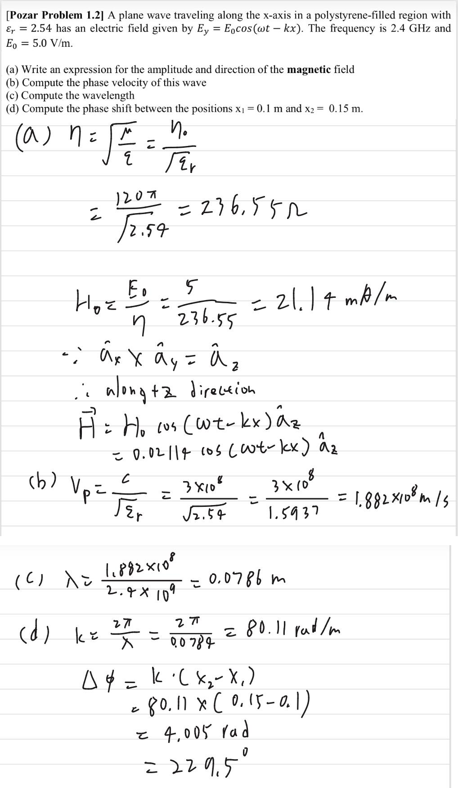
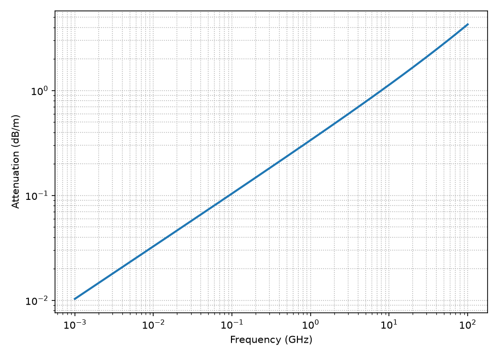
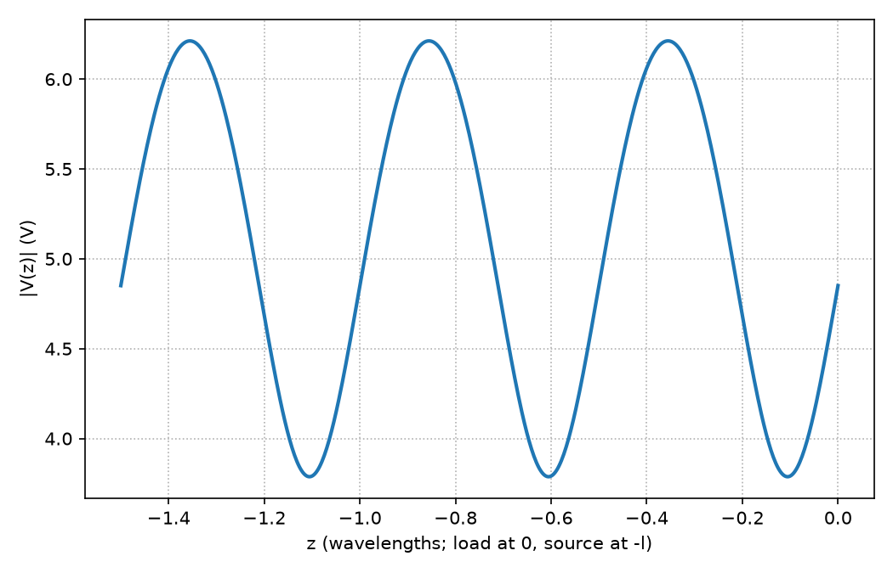
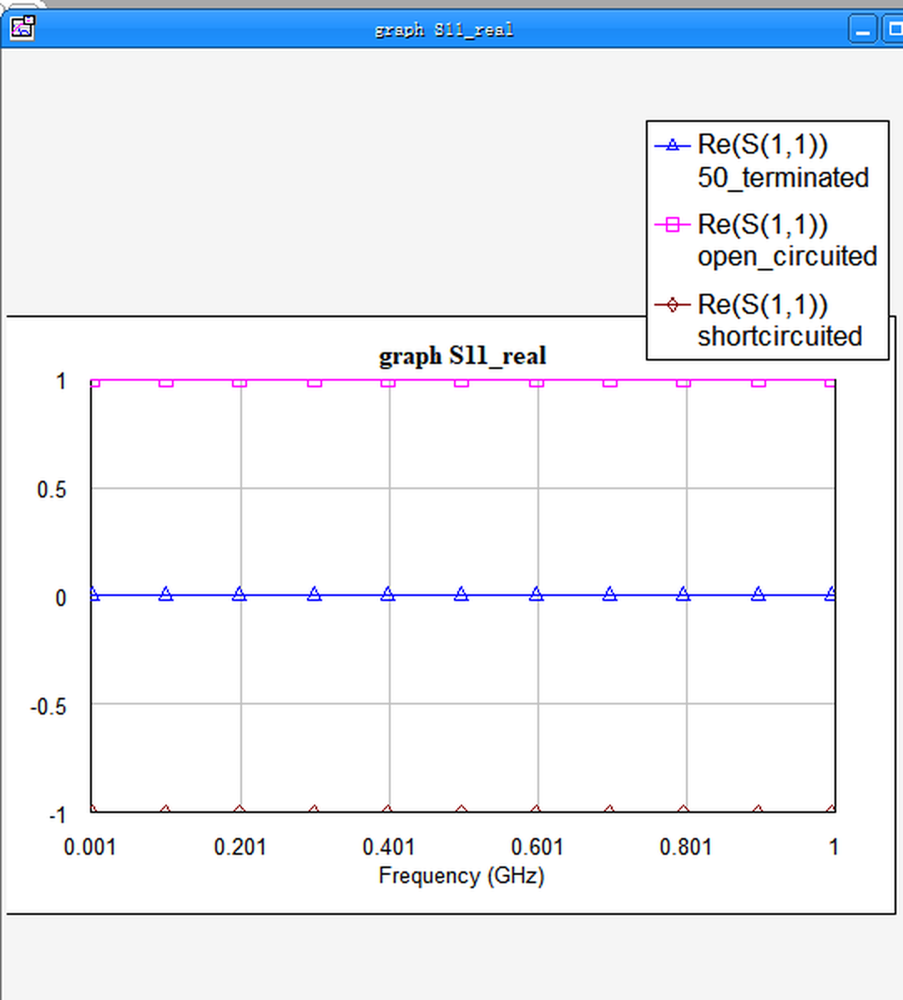
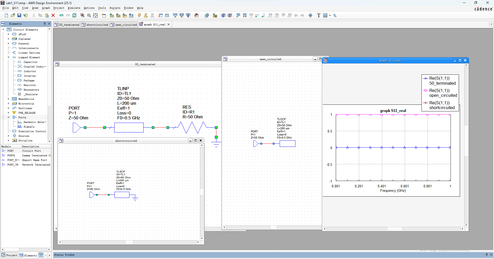
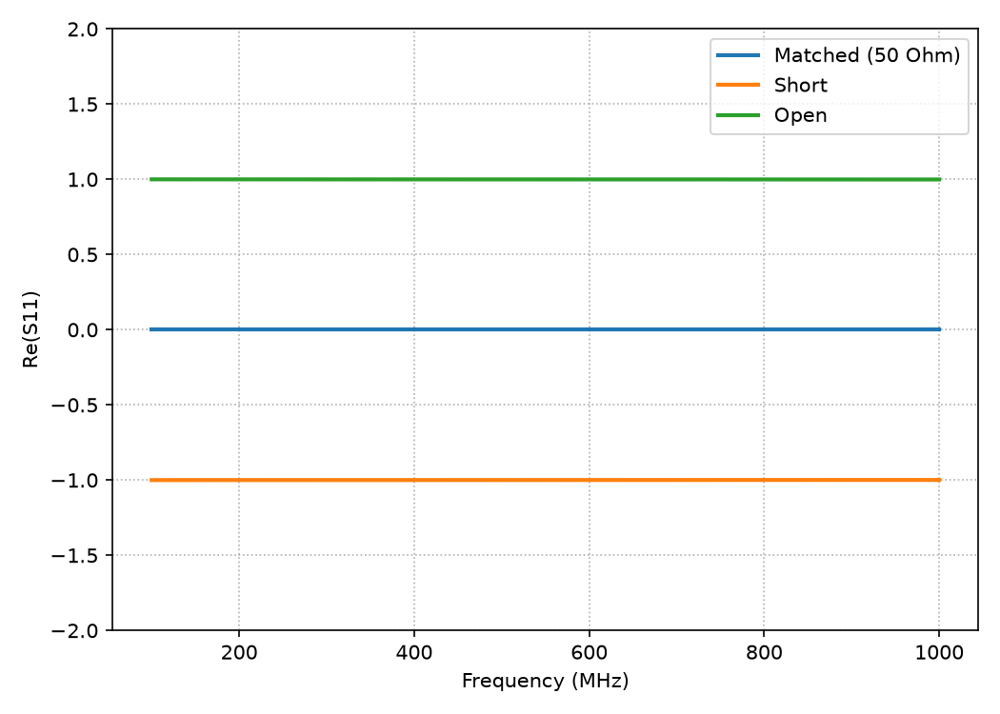
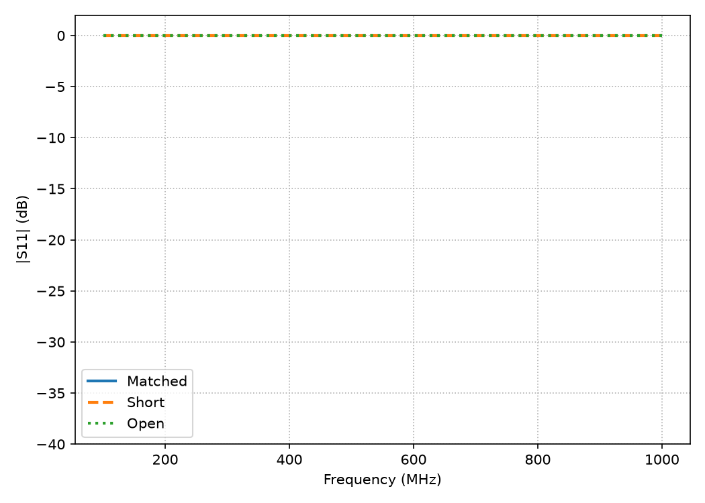
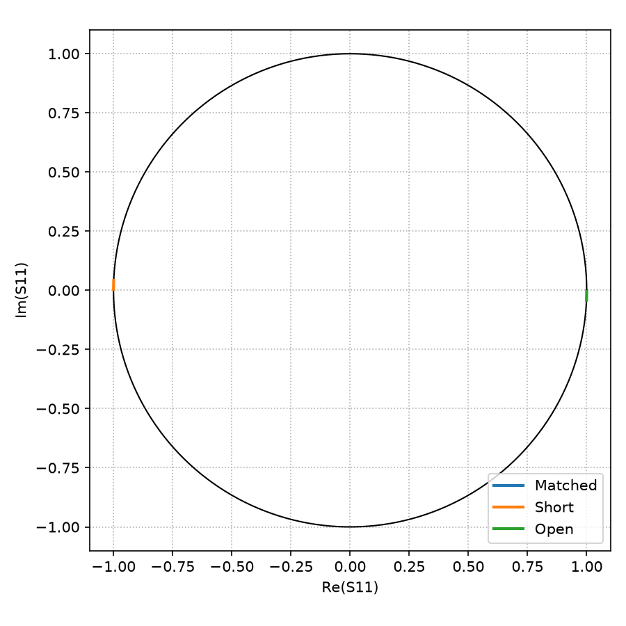

# Transmission-Line Characterisation and Reflection Coefficient

Per-unit-length parameter extraction, standing-wave analysis and a three-termination
reflection-coefficient study, worked analytically and cross-checked in AWR Design Environment.

- **Topics:** uniform plane waves, per-unit-length parameters of coaxial cable, conductor and
  dielectric loss, input impedance, voltage standing waves, S-parameters.

---

## What is in here

| Topic | File |
|---|---|
| Plane wave in polystyrene: H field, phase velocity, wavelength, phase shift | `plane_wave.py` |
| RG-402U coax: R, L, G, C, Z₀, attenuation vs frequency | `coaxial_line_parameters.py` |
| Voltage distribution \|V(z)\| on a terminated line | `terminated_line_voltage.py` |
| Reflection coefficient for matched / short / open terminations | `s11_reflection.py` |

---

## Plane wave in polystyrene

A uniform plane wave `E = E₀ cos(ωt − kx) â_y` propagates along +x through
polystyrene (ε_r = 2.54, non-magnetic), f = 2.4 GHz, E₀ = 5.0 V/m.

The wave impedance follows from a non-magnetic dielectric, η = η₀/√ε_r, and the
H field points along +z because `â_x × â_y = â_z`.

| Quantity | Result |
|---|---|
| Wave impedance η | 236.4 Ω |
| H amplitude H₀ = E₀/η | 21.1 mA/m, along +z |
| Phase velocity v_p = c/√ε_r | 1.882 × 10⁸ m/s |
| Wavelength λ = v_p/f | 78.4 mm |
| Phase constant k = 2π/λ | 80.11 rad/m |
| Phase shift over Δx = 0.05 m | 4.005 rad = 229.5° |



The script recomputes every number above so the arithmetic can be checked.

---

## RG-402U semirigid coaxial cable

Copper inner conductor (0.91 mm diameter) and copper outer conductor
(3.02 mm inner diameter) with a Teflon dielectric (ε_r = 2.08, tan δ = 4 × 10⁻⁴).

Per-unit-length parameters use the standard coaxial expressions with a skin
depth δ_s = √(2/ωμσ):

```
L = (μ/2π) ln(b/a)                 C = 2πε / ln(b/a)
R = (1/2πa + 1/2πb) / (σ δ_s)      G = ωε tan δ
```

**At 1 GHz:**

| Parameter | Value |
|---|---|
| R | 3.751 Ω/m |
| L | 239.9 nH/m |
| G | 4.63 × 10⁻⁵ S/m |
| C | 96.46 pF/m |
| Z₀ = √(L/C) | **49.87 Ω** (spec: 50 Ω) |
| α | **0.337 dB/m** (spec: 0.43 dB/m) |

Splitting the loss: conductor 0.327 dB/m, dielectric 0.010 dB/m.



**Discussion.** Z₀ lands within 0.26% of the 50 Ω spec — consistent with using a nominal
ε_r = 2.08 rather than a measured value for the Teflon batch. The attenuation, however, comes
out about 22% below the datasheet. The dielectric term is negligible at 1 GHz, so nearly all of
the gap sits in R/(2Z₀): the textbook `R_s = 1/(πδ_s)` assumes a perfectly smooth conductor,
while the real surface has roughness comparable to the skin depth (≈2 µm at 1 GHz), which
inflates R by roughly 10–20%. The 0.43 dB/m figure is also a room-temperature worst case, and at
elevated temperature the dielectric contribution grows. The low-loss model therefore gives a
reasonable lower bound on attenuation rather than a prediction accurate to a few percent.

The log-log sweep shows the expected α ∝ √f slope over the whole 1 MHz–100 GHz range, with the
dielectric term only becoming visible in the millimetre-wave end.

---

## Voltage along a terminated line

V_g = 10 V with R_s = 100 Ω drives a Z₀ = 100 Ω line of length l = 1.5 λ,
terminated in Z_L = 80 − j40 Ω.

Rather than solving a 2×2 boundary-value system, the source-end voltage is obtained from the
input impedance of the terminated line and a voltage divider:

```
Z_in = Z₀ (Z_L + jZ₀ tan βl) / (Z₀ + jZ_L tan βl)
V₀   = V_g Z_in / (R_s + Z_in)
```

With βl = 3π the line is an integer number of half-wavelengths, so Z_in = Z_L exactly — a useful
sanity check.

| Quantity | Result |
|---|---|
| Load reflection coefficient Γ_L | −0.0588 − j0.2353, \|Γ_L\| = 0.243 |
| Forward wave V⁺ | 5.00 V |
| Backward wave V⁻ | −0.294 − j1.176 V |
| \|V(z)\| range | ≈ 3.8 V to 6.2 V |



The 1.5 λ span shows three maxima and three minima; the moderate mismatch (|Γ| ≈ 0.24) gives a
standing-wave ratio of about 1.64.

---

## Reflection coefficient for three terminations

Built in **AWR Design Environment 25.1**. Three schematics were assembled from the built-in ideal
transmission-line models — `TLINP` (matched), `TLOCP` (open), `TLSCP` (short) — each with
Z₀ = 50 Ω, L = 200 µm and F0 = 0.5 GHz, and the results plotted in a graph named `S11_real`
across 1 MHz – 1 GHz.

| Schematic | Termination | Re(S11) |
|---|---|---|
| `50_terminated` | 50 Ω to ground | 0.00 |
| `open_circuited` | open circuit | **+1.00** |
| `shortcircuited` | short circuit | **−1.00** |



The full workspace with all three schematics open:



**Independent analytic check.** `s11_reflection.py` recomputes the same three cases from the
input-impedance formula using a 1 mm line. It reproduces 0 / −1 / +1 as well; because that line
is slightly longer than the AWR model, the short and open traces pick up a small slope rather
than sitting perfectly flat — same result, different route.






The magnitude and Smith-chart views show short and open on the unit circle at opposite ends of
the real axis, with the matched case at the centre.

> Worth noting: at exactly λ/4 the roles invert (short → +1, open → −1) — the quarter-wave
> transformer effect. The AWR models use L = 200 µm, far below λ/4 at these frequencies, which is
> why the traces stay flat at the load values.

The AWR project itself is included in `awr/s11_reflection/` (`Lab1_S11.emp`, its `.vin`, the
exported `50_terminated.net`, and the `S11_real` data set), so the three schematics and the graph
can be reopened in AWR 25.1.

---

## Repository layout

```
.
├── plane_wave.py                   # plane wave quantities
├── coaxial_line_parameters.py      # R, L, G, C, Z0, attenuation sweep
├── terminated_line_voltage.py      # |V(z)| on a terminated line
├── s11_reflection.py               # S11 for matched / short / open
├── figures/                        # plots, AWR screenshots, handwritten solution
├── awr/
│   └── s11_reflection/             # AWR project: Lab1_S11.emp, .vin, data set
└── requirements.txt
```

## Running

```bash
pip install -r requirements.txt
python plane_wave.py
python coaxial_line_parameters.py
python terminated_line_voltage.py
python s11_reflection.py
```

Each script prints its results to stdout; the three plotting scripts also write PNGs into
`figures/`. Run them from this directory so the relative paths resolve.

## Environment

Python 3.13, NumPy 2.x, Matplotlib 3.x. No other dependencies.
