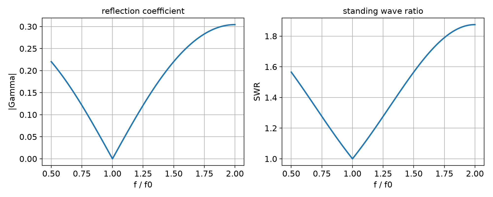

# Impedance Matching, Waveguide Loss and Planar Line Synthesis

Quarter-wave matching, rectangular-waveguide attenuation, stripline and microstrip synthesis, plus
a microstrip impedance-matching study built in AWR Microwave Office.

- **Topics:** quarter-wave transformers, waveguide conductor and dielectric loss, stripline /
  microstrip design, microstrip matching stubs, S-parameters.

---

## What is in here

| Topic | File |
|---|---|
| λ/4 transformer matching 40 Ω to 75 Ω: \|Γ\| and SWR vs f/f₀ | `quarter_wave_transformer.py` |
| WR-42 copper waveguide (ε_r = 2.55): α_d, α_c, total loss, phase delay | `waveguide_loss.py` |
| 100 Ω stripline (1.02 mm spacing) and 100 Ω microstrip (0.51 mm substrate) | `stripline_microstrip_synthesis.py` |
| Microstrip matching in AWR: reflection, width tuning, capacitive / inductive stubs | `microstrip_matching.py` |

---

## Quarter-wave transformer (40 Ω → 75 Ω)

The matching section must present Z₀ = √(Z_s R_L) = √(75 × 40) = **54.77 Ω** at the design
frequency, where its length is λ/4.

```python
Zt = sqrt(Z0 * RL)                       # 54.77 ohm
bl = pi / 2 * (f / f0)                   # electrical length vs frequency
Zin = Zt * (RL + 1j * Zt * tan(bl)) / (Zt + 1j * RL * tan(bl))
G = (Zin - Z0) / (Zin + Z0)
```

| f/f₀ | \|Γ\| | SWR |
|---|---|---|
| 0.50 | 0.2204 | 1.565 |
| 0.75 | 0.1214 | 1.276 |
| **1.00** | **0.000** | **1.000** |
| 1.25 | 0.1214 | 1.276 |
| 1.50 | 0.2204 | 1.565 |
| 2.00 | 0.3043 | 1.875 |



At f/f₀ = 1 the section is λ/4, so Z_in = Z_t²/R_L = 75 Ω and the line is matched. Moving to
f/f₀ = 2 makes it λ/2, where Z_in = Z_L = 40 Ω — the worst point in the swept band. The next null
is at f/f₀ = 3, so the transformer is a narrowband device.

---

## WR-42 copper waveguide, 10 cm at 15 GHz

Filling the guide with ε_r = 2.55 lowers every cutoff, so the mode count is checked first with
f_c = (c/2√ε_r)·√((m/a)² + (n/b)²):

| Mode | f_c (GHz) |
|---|---|
| TE₁₀ | 8.78 |
| TE₂₀ | 17.56 |
| TE₀₁ | 21.85 |
| TE₁₁ | 23.54 |
| TE₂₁ | 28.03 |

Only TE₁₀ propagates at 15 GHz. Using k = 2πf√ε_r/c, β = √(k² − (π/a)²),
α_d = k² tan δ/(2β) and α_c = R_s(2bπ² + a³k²)/(a³bβkη):

| Quantity | Value |
|---|---|
| β | 406.8 rad/m |
| α_d | 0.464 Np/m = **4.031 dB/m** |
| α_c | 0.0495 Np/m = **0.430 dB/m** |
| total α | **4.461 dB/m** |
| loss over 10 cm | **0.446 dB** |
| phase delay βL | 40.68 rad = 2330.7° (= 170.7° mod 360°) |
| λ_g | 1.545 cm |
| time delay L/v_p | 0.432 ns (v_p = 2.317 × 10⁸ m/s) |

The dielectric term dominates because tan δ = 0.0015 is about four times the Teflon value in the
standard worked example (0.0004), while the copper term is essentially unchanged. Swapping the
dielectric back to Teflon reproduces that reference example to the last digit, which validates the
formula chain.

---

## 100 Ω stripline and microstrip

Both lines are TEM / quasi-TEM at 5 GHz, ε_r = 2.20, tan δ = 0.001, copper.

**Branch check.** √ε_r Z₀ = √2.2 × 100 = 148.3 Ω > 120 Ω, so the wide-line branch of the
stripline synthesis expression applies — not the branch used for a 50 Ω line.

**Stripline, b = 1.02 mm.** x = 30π/(√ε_r Z₀) − 0.441 = 0.1944, W/b = 0.85 − √(0.6 − x) = 0.2131,
so W = **0.2174 mm** (W_e/b = 0.1944, and W/b < 0.35 so the width correction is active).

| Quantity | Value |
|---|---|
| W | 0.2174 mm |
| α_d | 0.675 dB/m |
| α_c | 2.677 dB/m |
| total α | **3.351 dB/m** (≈ 0.136 dB/λ) |
| λ_g | 40.45 mm |

**Microstrip, d = 0.51 mm.** A = 2.2132, W/d = 8e^A/(e^{2A} − 2) = 0.8962 (< 2, first branch),
W = **0.4571 mm**, ε_e = 1.7582.

| Quantity | Value |
|---|---|
| W | 0.4571 mm |
| ε_e | 1.7582 |
| α_d | 0.477 dB/m |
| α_c | 3.506 dB/m |
| total α | **3.982 dB/m** (≈ 0.180 dB/λ) |
| λ_g | 45.25 mm |

The microstrip loses more overall: its dielectric contribution is diluted by the air above the
trace, but the current crowds into a narrower conductor, so conductor loss rises and dominates.
Re-substituting W/d = 0.8962 into the effective-permittivity expression returns Z₀ = 100.2 Ω,
confirming the synthesis.

---

## Microstrip matching in AWR

**Scenario.** 100 Ω microstrip on a 0.762 mm substrate (ε_r = 2.2, tan δ = 0.001), 1 oz copper
(t = 0.035 mm), 5 cm long, swept 2.0–3.0 GHz, port and load impedance 100 Ω. Built in
**AWR Design Environment 25.1** with the `MLIN` microstrip model; the four sub-circuits are saved
in `awr/`.

**(a) Width copied from the 0.51 mm design.** The 0.4571 mm width was synthesised for a 0.51 mm
substrate. On 0.762 mm it no longer gives 100 Ω: the microstrip expressions give
Z₀ = **118.65 Ω** (|Γ| = 0.085 at βl = 0). The AWR sweep shows a narrow null just above 2.2 GHz,
where βl = 180° makes the 5 cm line transparent, and residual reflection of about **−26 dB at
2 GHz** and **−22 dB at 3 GHz**.

**(b) Retune the width.** Keeping W/d fixed and scaling to the real thickness,
W = 0.8962 × 0.762 mm = **0.6829 mm**. Widening to this value pulls the whole band down by about
**13 dB** (the 2 GHz / 3 GHz readings move from −26 / −22 dB to **−39 / −32 dB**); the null stays,
because it is a half-wave property that does not depend on the width.

**(c) 5.0 pF at 2.5 GHz.** An open line has Z_in = −jZ₀ cot βl; for X_C = −1/(2πfC) = −12.73 Ω
this needs cot βl = 0.1273, βl = 82.74°, i.e. l = **20.80 mm** (short of λ/4 = 22.6 mm, still
capacitive). S11 phase = −2βl ≈ **−165.5°**.

**(d) 5.0 nH at 2.5 GHz.** For X_L = +78.54 Ω, cot βl = −0.7854, so βl = 128.15° — in the
(π/2, π) inductive window, not the shorter capacitive solution. l = **32.22 mm**.
S11 phase = −2βl ≈ **+103.7°**.

| Quantity | Value |
|---|---|
| Design width for 100 Ω on 0.762 mm | 0.6829 mm |
| ε_e (0.683 mm line) | 1.7582 |
| λ_g at 2.5 GHz | 90.5 mm |
| β at 2.5 GHz | 69.43 rad/m |
| (c) length for 5 pF | 20.80 mm |
| (d) length for 5 nH | 32.22 mm |

The AWR projects (`lab2a`–`lab2d`, plus the `lab2d` data set) are in `awr/`.

---

## Repository layout

```
.
├── quarter_wave_transformer.py     # quarter-wave transformer, |Gamma| and SWR
├── waveguide_loss.py               # WR-42 alpha_d, alpha_c, phase delay
├── stripline_microstrip_synthesis.py # stripline and microstrip synthesis
├── microstrip_matching.py          # matching widths, eps_e, stub lengths
├── figures/
│   └── quarter_wave_swr_gamma.png  # |Gamma| and SWR vs f/f0
├── awr/
│   ├── lab2a.emp  lab2b.emp  lab2c.emp  lab2d.emp   # AWR 25.1 projects
│   ├── lab2a.vin  lab2b.vin  lab2c.vin  lab2d.vin
│   └── lab2d_GRAPHS.DS0.dsf
└── requirements.txt
```

## Running

```bash
pip install -r requirements.txt
python quarter_wave_transformer.py
python waveguide_loss.py
python stripline_microstrip_synthesis.py
python microstrip_matching.py
```

Each script prints to stdout; `quarter_wave_transformer.py` also writes
`figures/quarter_wave_swr_gamma.png`. Run from this directory so the relative path resolves.

## Environment

Python 3.13, NumPy 2.x, Matplotlib 3.x. The `.emp` / `.vin` files open in AWR Design
Environment 25.1.
